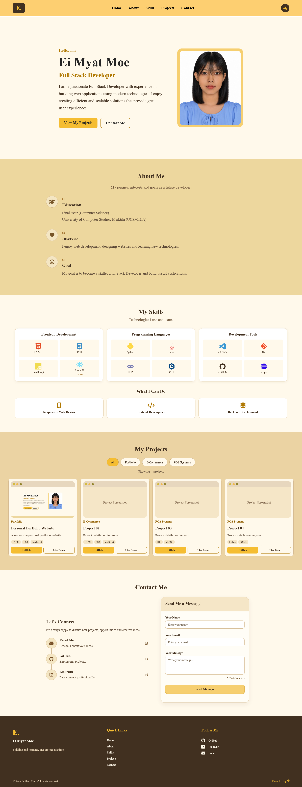
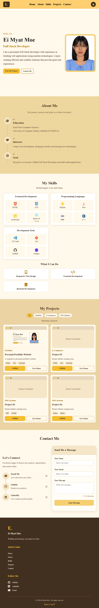
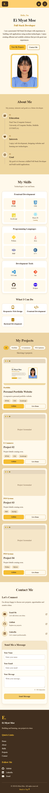
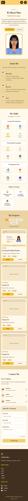
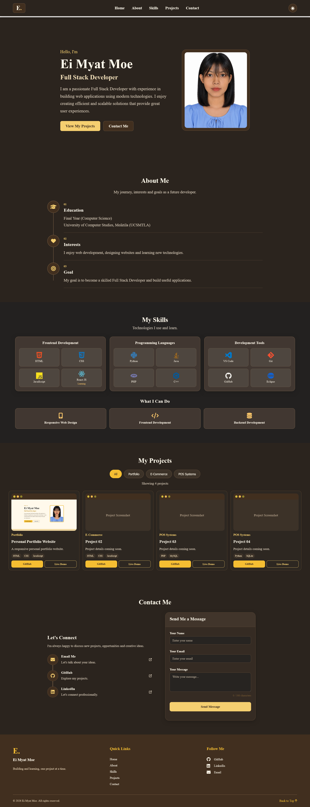

Personal Portfolio Website

Project Overview

This is my personal portfolio website built using HTML, CSS and JavaScript. It introduces my background, technical skills, learning progress and projects.

The website is designed to be responsive and user-friendly across desktop, tablet and mobile devices.

It also includes interactive features such as project filtering, a mobile navigation menu, light and dark modes and contact form validation.

Technologies Used

- HTML5       – Website structure and content.
- CSS3        – Styling, layouts and responsive design.
- JavaScript  – Interactive features and form validation.

Features

1. Responsive Design

- Supports desktop, tablet and mobile screen sizes.
- Uses flexible layouts for different devices.

2. Navigation

- Navigation links to the main sections.
- Mobile hamburger menu that opens and closes.
- Smooth scrolling between sections.

3. Light and Dark Mode

- Switches between light and dark themes.
- Saves the selected theme using localStorage.
- Restores the selected theme after refreshing the page.

4. About Me and Skills

- Introduces my background and learning goals.
- Displays my programming skills, frontend technologies and development tools.
- Identifies technologies I am currently learning.

5. Projects

- Displays four project cards.
- Organizes projects into categories.
- Filters projects without reloading the page.
- Shows the number of visible projects.
- Includes GitHub and Live Demo links where available.

6. Contact Form

- Includes name, email and message fields.
- Validates user input and displays error messages.
- Shows a live message character count.
- Displays a demo-only confirmation for valid input.
- Does not send or store messages.

Project Structure

Portfolio/
├── assets/
│   └── images/
│       ├── profile.jpg
│       ├── portfolio1.png
│       ├── desktop.png
│       ├── tablet.png
│       ├── mobile.png
│       ├── mobile_small.png
│       └── darkmode.png
├── css/
│   └── style.css
├── js/
│   └── main.js
├── index.html
└── README.md

How to Run

1. Download or clone this repository from GitHub.
2. Open the project folder in Visual Studio Code.
3. Open "index.html" in a web browser or use the Live Server extension.
4. Explore the portfolio website.

No additional packages or installation are required.

## Screenshots

### Desktop View

### Tablet View

### Mobile View

### Dark Mode

About Me

Hi, I'm Ei Myat Moe, a final-year Computer Science student interested in Full Stack Development.

I enjoy building websites, exploring new technologies and improving my problem-solving skills through practical projects.

I am currently looking for an internship opportunity where I can apply my technical knowledge, gain real-world development experience and continue learning from experienced developers.

Contact

Feel free to connect with me for internship opportunities, collaboration or technical discussions.

- GitHub: "My GitHub Profile" (https://github.com/eimyatmoe)
- Portfolio: "View My Portfolio" (https://eimyatmoe.github.io/personal-portfolio/)

Known Limitations

- The contact form is a frontend demonstration and does not send or save messages.
- Some project cards are placeholders for future projects.
- GitHub and demo links for unfinished projects are not yet available.

Future Improvements

- Complete unfinished projects and add working GitHub and demo links.
- Continue improving accessibility and responsive layouts.
- Add more projects as I develop new technical skills.
- Update the portfolio with new skills and learning experiences.

Credits

- Font Awesome – Interface icons.
- Devicon – Programming and technology icons.
- HTML, CSS and JavaScript – Technologies used for website development.

---

Developed by Ei Myat Moe using HTML, CSS and JavaScript.